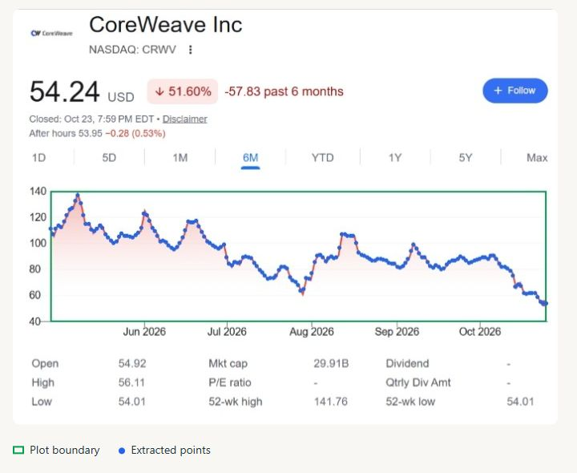
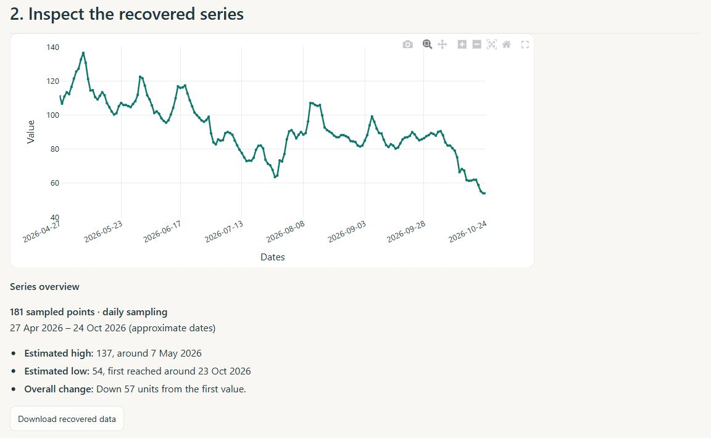
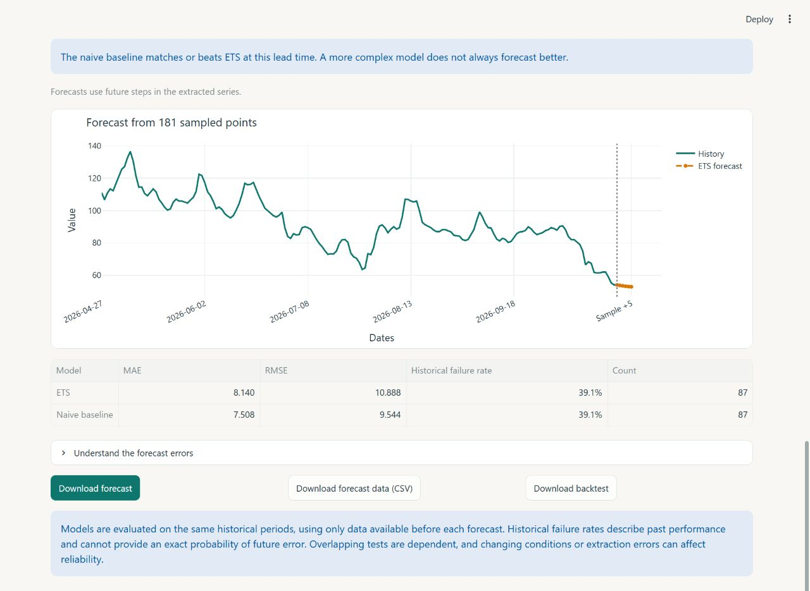

# Time Series Digitizer & Forecaster

Turn a chart image into numerical data, generate a forecast, and check how the model performed on historical observations.

Built with Python, Streamlit, OpenCV, RapidOCR, Statsmodels and Plotly. Images are processed locally; no external AI service is used.

## Quick start

Use Python 3.11 or newer. Open a terminal in the project folder and run:

```powershell
python -m venv .venv
.\.venv\Scripts\python -m pip install -r requirements.txt
.\.venv\Scripts\python -m streamlit run app.py
```

On macOS or Linux, replace `.\.venv\Scripts\python` with `.venv/bin/python`.

The app opens in your browser. Try **Demo → Trend**, **Wave**, or **Level shift**, or choose **Upload** for a PNG/JPG chart.

The first uploaded chart may download approximately 30 MB of OCR models. After that, OCR runs offline. If automatic reading is unavailable, the fields can be filled manually.

## Using the app

The screenshots below follow the upload of this [CRWV chart](tests/fixtures/market/area_left_axis_full.png).

### 1. Check calibration

Upload a chart or choose a demo. The app suggests the plot area, curve color and axis values. Check that the green border surrounds the plot and the extracted points follow its line. Correct any fields that do not match your image; pixel controls are under **Adjust plot rectangle (pixels)**.



### 2. Inspect the recovered series

Review the reconstructed curve and its overview: period, estimated high, estimated low and overall change. **Download recovered data** saves the values as CSV.

**Extraction points** uses a suggested original count when available. Otherwise, full date ranges use daily calendar samples; other charts start with 100 evenly spaced samples. These are interpolated samples, which may differ from the original observations. You can change the count.



### 3. Forecast and evaluate

Choose a forecast horizon, initial training size and model. Results update automatically.

| Option | Purpose |
| --- | --- |
| **ETS** · default | Exponential smoothing with a damped trend. |
| **ARIMA** | A small set of models that use dependence between observations. |
| **Naive** | Repeats the last value; a simple baseline. |
| **Auto** | Selects a model using earlier data, then evaluates it on later data. |

**Failure tolerance (%)** defaults to **±10%** of each actual value. For example, when the actual value is 60, predictions from 54 to 66 are within tolerance. MAE and RMSE remain in the original value units.

Open **Understand the forecast errors** for the error distribution and accuracy at each lead time. Download the interactive forecast chart as an offline HTML file, or export forecasts and backtest results as CSV.



## How validation works

The app uses **expanding-window rolling backtesting**: fit on the available history, predict the next segment, compare with its actual values, move forward one observation and repeat. Each fit uses only data preceding its forecast origin. The final forecast uses the complete recovered series.

- **MAE:** average absolute prediction error.
- **RMSE:** gives larger errors more weight.
- **Historical failure rate:** share of forecasts outside your percentage tolerance, at the selected lead time.

**Auto** compares models at up to five common origins within the initial training data. Lowest failure rate wins; ties use MAE, then the simpler model. That choice stays fixed during the later backtest, so selection and evaluation scores can differ.

A historical failure rate is **not an exact probability of future error**. Overlapping tests share data, and changing conditions or extraction errors can affect reliability. Backtests on interpolated samples evaluate the sampled curve and can appear more accurate than tests on original observations. No prediction interval is claimed.

## Supported charts and limits

Use a clear, single colored line with a linear value axis. Numeric labels, English weekdays/months, dates and clock times are supported, including some shaded financial line charts. Automatic calibration remains editable.

- Candlesticks, black lines, multiple series, logarithmic scales and heavily obscured curves are outside scope.
- Extraction supports 5–300 points for forecasting. ARIMA needs at least 12 initial training observations plus the horizon.
- Images cannot reliably reveal the original observation count or sampling frequency. Estimated endpoints are approximate; trading calendars are not reconstructed.
- Temporal forecasts use future observation/sample steps rather than invented calendar dates.
- Percentage errors are sensitive near zero. At an actual value of zero, only an exact prediction is within tolerance.

## Project structure and tests

The pipeline detects the plot, traces the curve by color, reads axis labels locally, and maps pixel coordinates to values before forecasting.

| File | Responsibility |
| --- | --- |
| `app.py` | Interface, charts and downloads |
| `extraction.py` | Plot detection and curve extraction |
| `calibration.py` | Local OCR and axis calibration |
| `time_axis.py` | Time labels, sampling and series overview |
| `forecasting.py` | Models, rolling validation, Auto selection and metrics |
| `tests/` | Extraction, forecasting, time-axis and UI checks |

Run the tests:

```powershell
.\.venv\Scripts\python -m pytest -q
```

The three demos include original CSV values in `sample_images/` for extraction accuracy checks. Regenerate them with `python generate_samples.py`. Tests also cover model fitting, future-data leakage, error metrics, invalid inputs and uploaded chart examples. Streamlit tests need local loopback connections.

A short video outline is available in [DEMO.md](DEMO.md).
